# 养老院管理系统（小程序--论文pf

> 🎓 **计算机毕业设计 · 养老院管理系统（小程序--论文pf**
>
> 本仓库只放**项目介绍 + 运行截图**（截图是站点带水印的原图，存在仓库 `images/` 里）。
>
> 👉 **完整可运行源码 / 数据库脚本 / 部署文档：[点我获取](https://geekcode.top/archives/%E5%85%BB%E8%80%81%E9%99%A2%E7%AE%A1%E7%90%86%E7%B3%BB%E7%BB%9F%EF%BC%88%E5%B0%8F%E7%A8%8B%E5%BA%8F-%E8%AE%BA%E6%96%87pf?utm_source=github)**
>
> 💬 咨询微信：**ir9372**　|　🌐 更多项目：[极客代码 geekcode.top](https://geekcode.top/?utm_source=github)
>
> 📌 项目详情页：<https://geekcode.top/archives/%E5%85%BB%E8%80%81%E9%99%A2%E7%AE%A1%E7%90%86%E7%B3%BB%E7%BB%9F%EF%BC%88%E5%B0%8F%E7%A8%8B%E5%BA%8F-%E8%AE%BA%E6%96%87pf?utm_source=github>

<table><td width="230" align="center"> <b>扫码加微信 ir9372</b></td><td valign="middle">📦 源码 = 项目介绍 + 全部运行截图 + 数据库 + 部署文档 👉 点上方任意截图，直接跳到 <b>极客代码 geekcode.top</b> 详情页</td></table>

---

<h1>养老院管理系统（小程序--论文pf</h1>
<h2>项目概述</h2>

本项目旨在开发一套面向养老院场景的综合管理系统，采用“微信小程序前端 + Java Web后台”的双端架构。系统核心目标是实现养老院日常运营的数字化管理，涵盖床位预约、人员调动、出院申请、公告发布及健康档案记录等关键业务。适用人群包括养老院管理员、护工及入住老人（或其家属）。技术架构上，后端基于 Spring Boot 框架构建 RESTful API 服务，使用 MyBatis-Plus 进行数据持久化，Shiro 处理权限控制；前端分为两部分：Web 端使用 Thymeleaf 模板引擎提供管理后台界面，移动端通过微信小程序提供用户交互入口。该系统有效解决了传统养老院信息分散、流程审批效率低的问题，实现了多角色协同与数据实时同步。

<h2>技术架构</h2>

本系统采用前后端分离与混合渲染相结合的技术架构，确保系统的可维护性与扩展性。

<strong>1. 后端架构设计</strong>
后端基于 Java 语言，核心框架为 Spring Boot。利用 <code>spring-boot-starter-web</code> 构建 HTTP 服务层，通过 Controller 接收请求并调用 Service 层逻辑。数据访问层采用 MyBatis-Plus (<code>mybatis-plus</code>, <code>mybatis-spring-boot-starter</code>)，简化了 CRUD 操作并支持复杂查询。安全模块集成 Apache Shiro (<code>shiro-spring</code>)，用于身份认证与会话管理。数据库选用 MySQL，通过 <code>mysql-connector-java</code> 驱动连接。配置文件中引入 <code>spring-boot-devtools</code> 以支持开发阶段的快速热部署。

<strong>2. 前端架构设计</strong>

<ul>
<li><strong>Web 管理后台</strong>：采用服务端渲染模式，使用 Thymeleaf (<code>spring-boot-starter-thymeleaf</code>) 作为模板引擎，直接由 Spring Boot 应用托管静态资源和动态页面，便于管理员在 PC 端进行全局配置和数据监控。</li>
<li><strong>微信小程序端</strong>：作为独立的用户客户端，不直接依赖后端模板渲染。小程序通过 HTTPS 协议调用后端提供的 REST API 接口获取 JSON 格式数据，实现登录注册、床位查看、申请提交等功能。这种解耦方式使得移动端体验更流畅，且便于后续迭代。</li>
</ul>

<strong>3. 数据交互机制</strong>
小程序前端与 Java 后端之间完全通过 RESTful API 进行通信。后端定义了统一的接口规范，涵盖用户认证、字典数据获取、业务单据提交等模块。所有敏感操作均经过 Shiro 拦截器校验 Token 或 Session ID，确保数据传输的安全性。

<a href="https://geekcode.top/archives/%E5%85%BB%E8%80%81%E9%99%A2%E7%AE%A1%E7%90%86%E7%B3%BB%E7%BB%9F%EF%BC%88%E5%B0%8F%E7%A8%8B%E5%BA%8F-%E8%AE%BA%E6%96%87pf?utm_source=github" title="查看完整源码">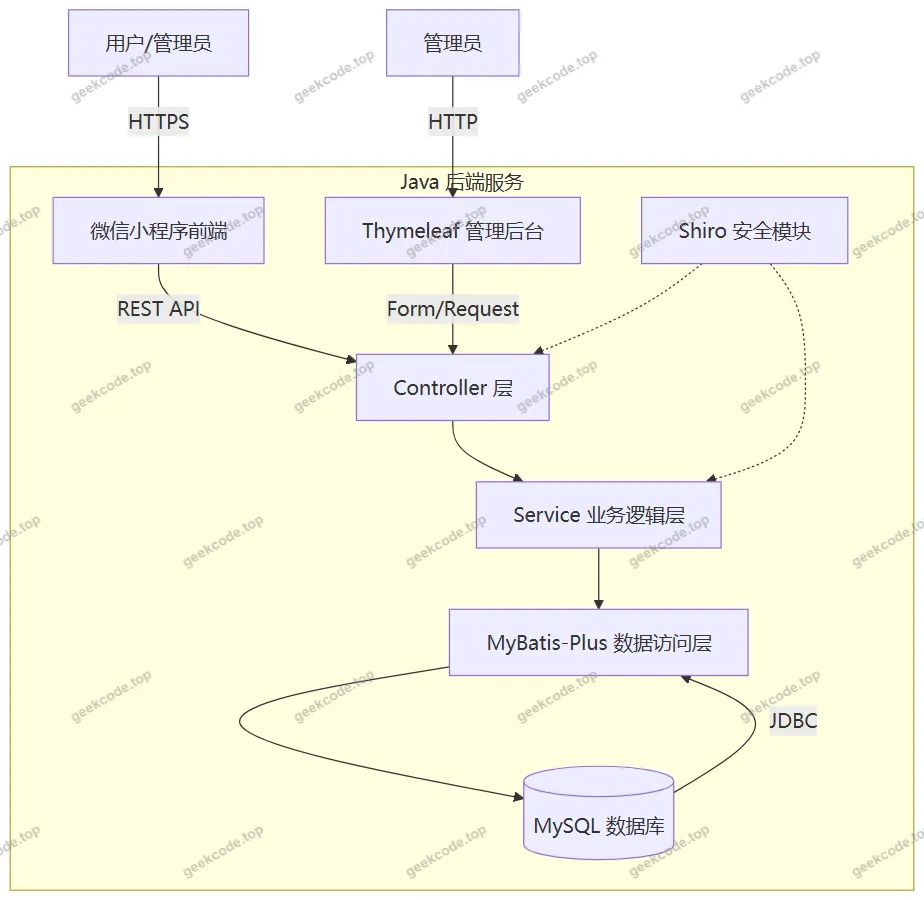</a>

<h2>功能模块</h2>

根据代码上下文中的 Controller 列表、后台路由及小程序截图功能，系统主要划分为以下两大功能模块：

<h3>1. Web 后台管理端 (Admin)</h3>

该模块主要供养老院管理人员使用，侧重于基础数据配置、业务流程审批及全局监控。

<ul>
<li><strong>系统配置与字典管理</strong>：</li>
<li><strong>配置文件管理</strong> (<code>/config</code>)：管理系统的全局参数设置。</li>
<li><strong>字典管理</strong> (<code>/dictionary</code>)：维护系统的基础枚举值，包括性别 (<code>dictionarySex</code>)、用户类型 (<code>dictionaryYonghu</code>)、房间状态 (<code>dictionaryFangjian</code>)、公告类别 (<code>dictionaryGonggao</code>)、各类申请状态（如床位预约 YesNo、出院 YesNo、调动 YesNo、护工 YesNo、请假 YesNo、离职 YesNo、启用状态 Jinyong 等）。这是支撑业务逻辑的核心基础数据。</li>
<li><strong>资源管理</strong>：</li>
<li><strong>房间管理</strong> (<code>/fangjian</code>)：录入和维护养老院的物理房间信息。</li>
<li><strong>床位管理</strong> (<code>/chuangwei</code>)：关联房间，管理具体床位的分配与状态。</li>
<li><strong>业务审批与管理</strong>：</li>
<li><strong>床位预约管理</strong> (<code>/chuangweiYuyue</code>)：审核和处理用户的床位预订申请。</li>
<li><strong>调动管理</strong> (<code>/diaodong</code>)：处理员工或老人的岗位/房间调动申请。</li>
<li><strong>出院管理</strong> (<code>/chuyaun</code>)：审核老人的出院申请流程。</li>
<li><strong>请假与离职管理</strong>：虽然路由中未直接显示独立的请假 Controller，但结合字典项 <code>laorenqingjia</code> (老人请假) 和 <code>lizhi</code> (离职)，以及截图中的“请假申请列表”、“离职申请列表”，推断后台具备对应的审核入口，可能集成在通用业务控制器或特定路由中（如 <code>/jilu</code> 记录管理或隐含的业务路由）。</li>
<li><strong>公告管理</strong> (<code>/gonggao</code>)：发布养老院通知，同步至小程序首页。</li>
<li><strong>人员管理</strong>：</li>
<li><strong>管理员管理</strong> (<code>/users</code>)：维护后台登录账号。</li>
<li><strong>护工管理</strong> (<code>/hugong</code>)：管理护理人员信息。</li>
<li><strong>老人管理</strong> (<code>/laoren</code>)：维护入住老人的基本档案。</li>
<li><strong>家属管理</strong> (<code>/jiashu</code>)：关联老人与家属的信息。</li>
<li><strong>备份管理</strong> (<code>/beifen</code>)：执行数据库或系统数据的备份操作。</li>
<li><strong>环员/其他</strong> (<code>/huanyuan</code>)：对应截图中的特定业务模块，可能涉及环境或人员轮换相关管理。</li>
</ul>
<h3>2. 微信小程序用户端 (Mini Program)</h3>

该模块面向护工、老人及家属，提供便捷的信息查询和业务发起入口。

<ul>
<li><strong>用户中心</strong>：</li>
<li><strong>登录与注册</strong>：支持新用户注册及现有用户登录。</li>
<li><strong>忘记密码与修改密码</strong>：提供账户安全找回与凭证更新功能。</li>
<li><strong>个人信息管理</strong> (<code>userinfo</code>)：查看和编辑个人基本资料。</li>
<li><strong>信息查询</strong>：</li>
<li><strong>首页展示</strong>：聚合显示最新公告、快捷入口及个人待办事项。</li>
<li><strong>公告信息</strong>：浏览后台发布的养老院通知。</li>
<li><strong>床位与房间列表</strong>：查看当前可用的床位资源及房间分布情况。</li>
<li><strong>老人列表</strong>：护工或管理员可查看负责的老人名单。</li>
<li><strong>健康信息列表</strong>：查看老人的健康档案记录。</li>
<li><strong>业务申请</strong>：</li>
<li><strong>床位调动申请</strong>：发起床位调整请求，并查看申请状态。</li>
<li><strong>请假申请</strong>：提交个人或老人的请假单。</li>
<li><strong>离职申请</strong>：员工提交离职流程。</li>
</ul>
<h2>用户角色与权限</h2>

系统基于 Shiro 框架实现细粒度的权限控制，主要包含以下两类角色：

<strong>1. 超级管理员 / 后台管理员 (Admin)</strong>

<ul>
<li><strong>接入端</strong>：Web 浏览器。</li>
<li><strong>权限范围</strong>：拥有系统的最高权限。</li>
<li><strong>全量数据访问</strong>：可以查看、新增、修改、删除所有业务数据（房间、床位、老人、护工、家属等）。</li>
<li><strong>流程审批权</strong>：负责审核所有来自小程序端的申请，包括床位预约、调动、出院、请假、离职等。</li>
<li><strong>系统配置权</strong>：管理字典表、系统参数、管理员账号及数据备份。</li>
<li><strong>信息发布权</strong>：创建和管理公告内容。</li>
</ul>

<strong>2. 普通用户 (小程序端用户)</strong>

<ul>
<li><strong>接入端</strong>：微信小程序。</li>
<li><strong>细分角色</strong>：根据 <code>dictionaryYonghu</code> (用户字典) 的存在，推测小程序端用户可能进一步区分为“护工”、“老人/家属”等子角色，但在前端截图功能中表现为统一的用户视图，具体权限如下：</li>
<li><strong>只读/有限写权限</strong>：</li>
<li><strong>查询权限</strong>：可查看公告、床位状态、房间列表、自己相关的健康信息或老人列表（取决于具体业务逻辑绑定）。</li>
<li><strong>申请权限</strong>：只能发起针对自身或所辖对象的业务申请（如请假、离职、床位调动），不能直接修改最终状态。</li>
<li><strong>个人中心</strong>：仅能修改自己的密码和个人基本信息。</li>
<li><strong>隔离性</strong>：无法访问 Web 后台的管理功能，无法查看其他无关人员的隐私数据，无法进行系统级配置。</li>
</ul>
<h2>项目特色与创新点</h2>
<ol>
<li>
<strong>双端协同的工作流闭环</strong>：
   项目创新性地结合了 Web 后台的强管理能力与微信小程序的便捷触达能力。复杂的批量导入、系统配置和审批决策在 PC 端完成，而高频的轻量级操作（如查看公告、发起请假、查看床位）则在移动端完成。这种分工提升了养老院工作人员的操作效率，同时也方便了老人及其家属随时了解院内动态。

</li>
<li>
<strong>高度抽象的字典驱动架构</strong>：
   通过引入大量的字典表（如 <code>ChuangweiYuyueYesno</code>, <code>DiaodongYesno</code>, <code>LaorenqingjiaYesno</code> 等），系统将业务状态与代码逻辑解耦。这意味着当养老院的审批流程发生变化（例如增加一个新的中间状态）时，只需在后台修改字典配置即可，无需重新编译部署代码，极大地提高了系统的灵活性和可维护性。

</li>
<li>
<strong>全流程数字化档案管理</strong>：
   涵盖了从“入院（床位预约/分配）”到“在住（健康记录/请假/调动）”再到“离院（出院申请/离职）”的全生命周期管理。特别是将“家属”作为一个独立实体进行管理 (<code>/jiashu</code>)，体现了现代养老服务中对家庭关怀的重视，有助于建立更完善的沟通机制。

</li>
<li>
<strong>安全的权限隔离体系</strong>：
   利用 Shiro 框架实现了严格的 RBAC（基于角色的访问控制）模型雏形。通过区分后台管理员和前端普通用户，确保了核心业务数据的安全，防止非授权人员篡改关键配置或查看隐私信息。

</li>
</ol>
<h2>部署环境</h2>

为确保项目正常运行，需准备以下软硬件环境：

<strong>1. 硬件环境建议</strong>

<ul>
<li><strong>CPU</strong>: Intel Core i5 及以上或同等性能处理器。</li>
<li><strong>内存</strong>: 8GB RAM 及以上（推荐 16GB 以优化数据库缓存）。</li>
<li><strong>硬盘</strong>: SSD 固态硬盘，剩余空间至少 20GB。</li>
</ul>

<strong>2. 软件环境要求</strong>

<ul>
<li><strong>操作系统</strong>: Windows 10/11, macOS 或 Linux (CentOS 7+/Ubuntu 20.04+)。</li>
<li><strong>Java 运行环境</strong>: JDK 1.8 (Java SE Development Kit 8)。Spring Boot 版本通常兼容 JDK 8，若使用更高版本需确认依赖兼容性。</li>
<li><strong>数据库</strong>: MySQL 5.7 或 MySQL 8.0。需安装相应的 JDBC 驱动。</li>
<li><strong>构建工具</strong>: Maven 3.6+ (用于下载依赖和打包项目)。</li>
<li><strong>Web 服务器</strong>: 内置 Tomcat (由 Spring Boot Starter Web 提供，无需单独安装外部 Tomcat)。</li>
</ul>

<strong>3. 前端开发/运行环境</strong>

<ul>
<li><strong>微信开发者工具</strong>: 最新稳定版，用于调试和预览小程序代码。</li>
<li><strong>Node.js</strong>: 如果小程序源码基于 Vue 或其他需要编译的前端框架（提示中提到 <code>vue-integrated</code>），则可能需要 Node.js (LTS 版本) 配合 npm/yarn 进行构建。若小程序为原生 WXML/WXSS 编写，则仅需微信开发者工具。</li>
<li><strong>浏览器</strong>: Chrome, Edge 或 Firefox 最新版，用于访问 Web 管理后台。</li>
</ul>

<strong>4. 网络环境</strong>

<ul>
<li>稳定的互联网连接，以便小程序端能够访问后端 API 接口（生产环境需配置域名及 SSL 证书以满足微信小程序 HTTPS 强制要求；开发环境可通过 localhost 或局域网 IP 调试）。</li>
</ul>
<h2>五、技术特性</h2>
<ul>
<li>前后端集成部署，前端资源打包至后端 static 目录</li>
<li>使用 MyBatis-Plus 简化数据访问层开发</li>
<li>集成 Shiro 权限框架实现角色权限控制</li>
</ul>
<h2>六、功能模块截图</h2>
<h3>微信小程序用户端</h3>

<figure><a href="https://geekcode.top/archives/%E5%85%BB%E8%80%81%E9%99%A2%E7%AE%A1%E7%90%86%E7%B3%BB%E7%BB%9F%EF%BC%88%E5%B0%8F%E7%A8%8B%E5%BA%8F-%E8%AE%BA%E6%96%87pf?utm_source=github" title="查看完整源码">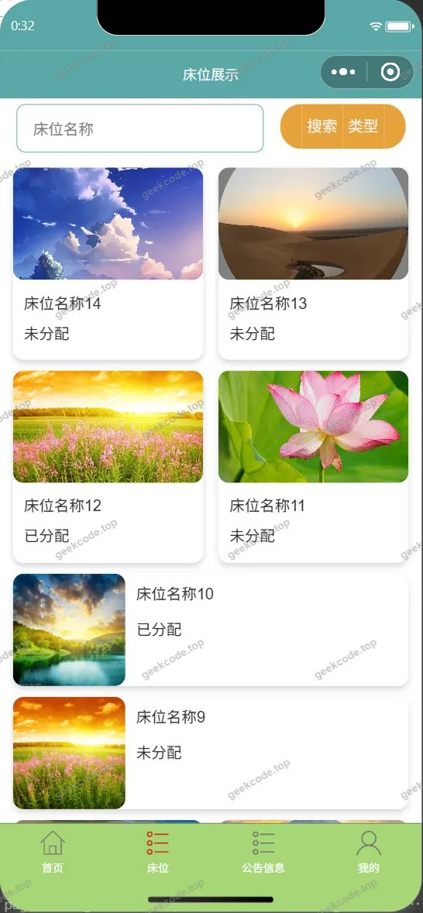</a><figcaption>小程序-床位</figcaption></figure>
<figure><a href="https://geekcode.top/archives/%E5%85%BB%E8%80%81%E9%99%A2%E7%AE%A1%E7%90%86%E7%B3%BB%E7%BB%9F%EF%BC%88%E5%B0%8F%E7%A8%8B%E5%BA%8F-%E8%AE%BA%E6%96%87pf?utm_source=github" title="查看完整源码">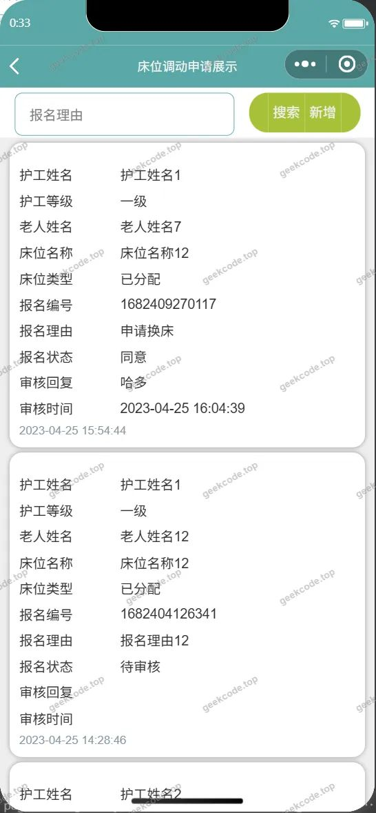</a><figcaption>小程序-床位调动申请列表</figcaption></figure>
<figure><a href="https://geekcode.top/archives/%E5%85%BB%E8%80%81%E9%99%A2%E7%AE%A1%E7%90%86%E7%B3%BB%E7%BB%9F%EF%BC%88%E5%B0%8F%E7%A8%8B%E5%BA%8F-%E8%AE%BA%E6%96%87pf?utm_source=github" title="查看完整源码">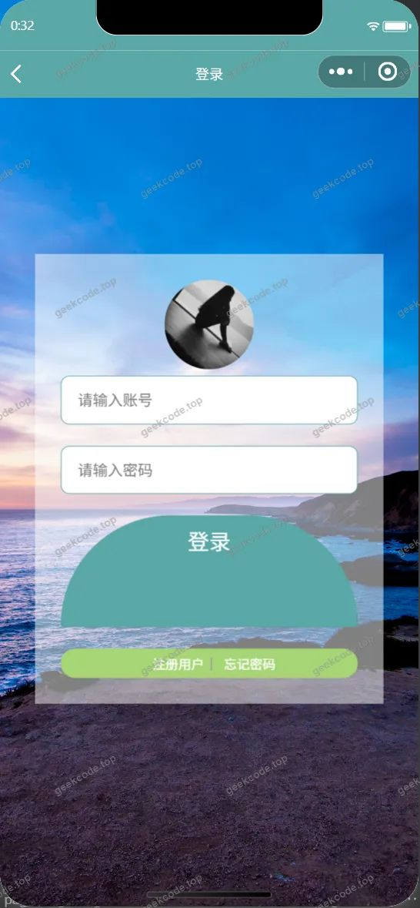</a><figcaption>小程序-登录</figcaption></figure>
<figure><figcaption>小程序-房间列表</figcaption></figure>
<figure><a href="https://geekcode.top/archives/%E5%85%BB%E8%80%81%E9%99%A2%E7%AE%A1%E7%90%86%E7%B3%BB%E7%BB%9F%EF%BC%88%E5%B0%8F%E7%A8%8B%E5%BA%8F-%E8%AE%BA%E6%96%87pf?utm_source=github" title="查看完整源码">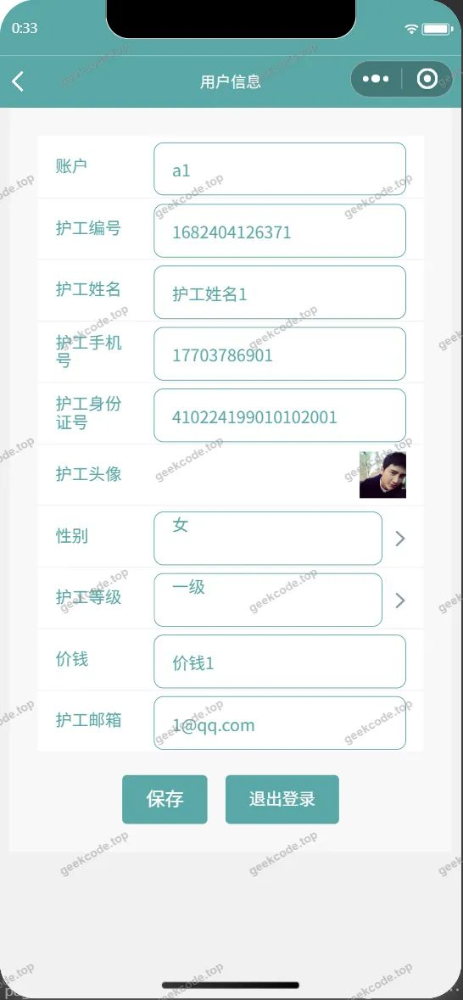</a><figcaption>小程序-个人信息userinfo</figcaption></figure>
<figure><a href="https://geekcode.top/archives/%E5%85%BB%E8%80%81%E9%99%A2%E7%AE%A1%E7%90%86%E7%B3%BB%E7%BB%9F%EF%BC%88%E5%B0%8F%E7%A8%8B%E5%BA%8F-%E8%AE%BA%E6%96%87pf?utm_source=github" title="查看完整源码">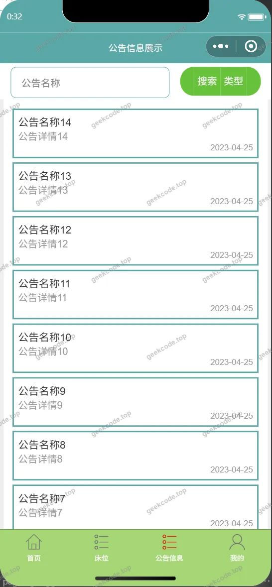</a><figcaption>小程序-公告信息</figcaption></figure>
<figure><a href="https://geekcode.top/archives/%E5%85%BB%E8%80%81%E9%99%A2%E7%AE%A1%E7%90%86%E7%B3%BB%E7%BB%9F%EF%BC%88%E5%B0%8F%E7%A8%8B%E5%BA%8F-%E8%AE%BA%E6%96%87pf?utm_source=github" title="查看完整源码">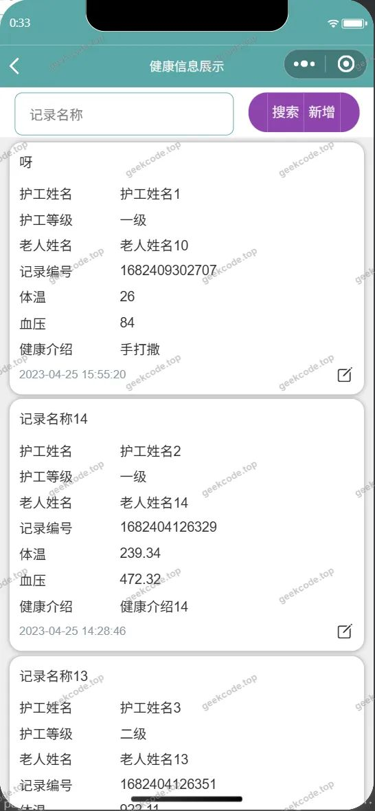</a><figcaption>小程序-健康信息列表</figcaption></figure>
<figure><a href="https://geekcode.top/archives/%E5%85%BB%E8%80%81%E9%99%A2%E7%AE%A1%E7%90%86%E7%B3%BB%E7%BB%9F%EF%BC%88%E5%B0%8F%E7%A8%8B%E5%BA%8F-%E8%AE%BA%E6%96%87pf?utm_source=github" title="查看完整源码">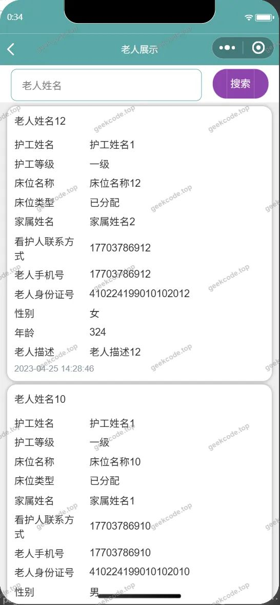</a><figcaption>小程序-老人列表</figcaption></figure>
<figure><a href="https://geekcode.top/archives/%E5%85%BB%E8%80%81%E9%99%A2%E7%AE%A1%E7%90%86%E7%B3%BB%E7%BB%9F%EF%BC%88%E5%B0%8F%E7%A8%8B%E5%BA%8F-%E8%AE%BA%E6%96%87pf?utm_source=github" title="查看完整源码">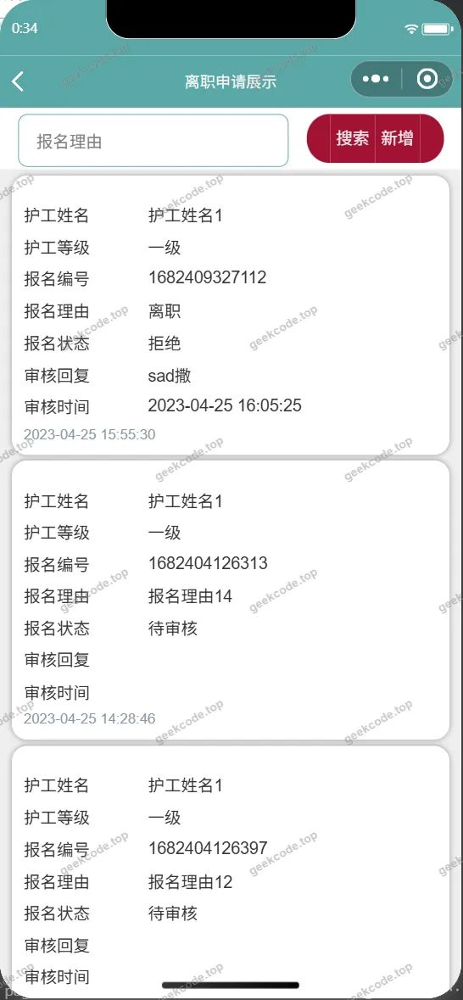</a><figcaption>小程序-离职申请列表</figcaption></figure>
<figure><a href="https://geekcode.top/archives/%E5%85%BB%E8%80%81%E9%99%A2%E7%AE%A1%E7%90%86%E7%B3%BB%E7%BB%9F%EF%BC%88%E5%B0%8F%E7%A8%8B%E5%BA%8F-%E8%AE%BA%E6%96%87pf?utm_source=github" title="查看完整源码">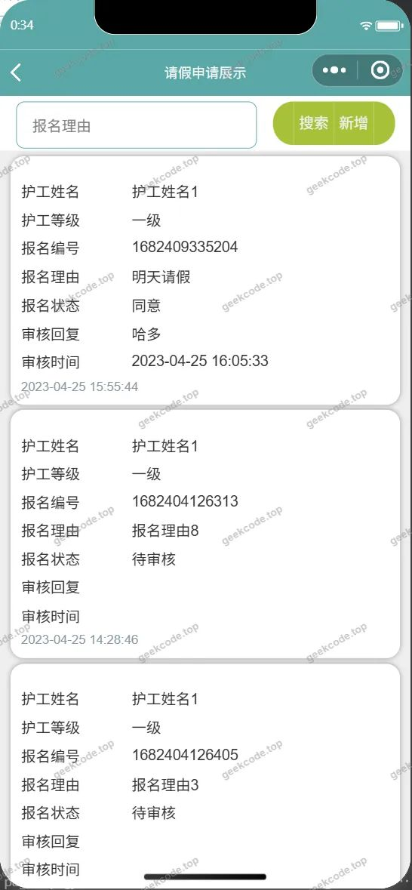</a><figcaption>小程序-请假申请列表</figcaption></figure>
<figure><figcaption>小程序-首页</figcaption></figure>
<figure><figcaption>小程序-忘记密码</figcaption></figure>
<figure><a href="https://geekcode.top/archives/%E5%85%BB%E8%80%81%E9%99%A2%E7%AE%A1%E7%90%86%E7%B3%BB%E7%BB%9F%EF%BC%88%E5%B0%8F%E7%A8%8B%E5%BA%8F-%E8%AE%BA%E6%96%87pf?utm_source=github" title="查看完整源码">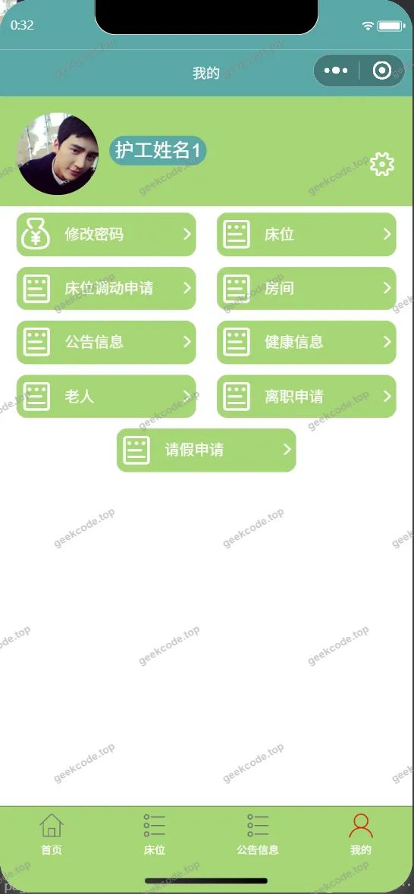</a><figcaption>小程序-我的</figcaption></figure>
<figure><a href="https://geekcode.top/archives/%E5%85%BB%E8%80%81%E9%99%A2%E7%AE%A1%E7%90%86%E7%B3%BB%E7%BB%9F%EF%BC%88%E5%B0%8F%E7%A8%8B%E5%BA%8F-%E8%AE%BA%E6%96%87pf?utm_source=github" title="查看完整源码">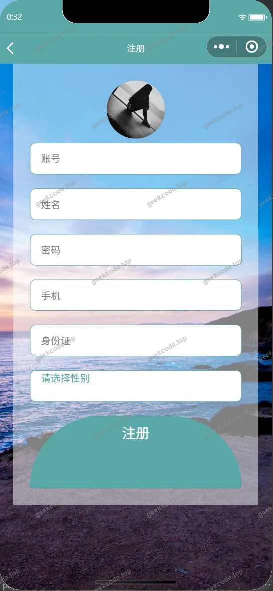</a><figcaption>小程序-注册</figcaption></figure>
<figure><a href="https://geekcode.top/archives/%E5%85%BB%E8%80%81%E9%99%A2%E7%AE%A1%E7%90%86%E7%B3%BB%E7%BB%9F%EF%BC%88%E5%B0%8F%E7%A8%8B%E5%BA%8F-%E8%AE%BA%E6%96%87pf?utm_source=github" title="查看完整源码">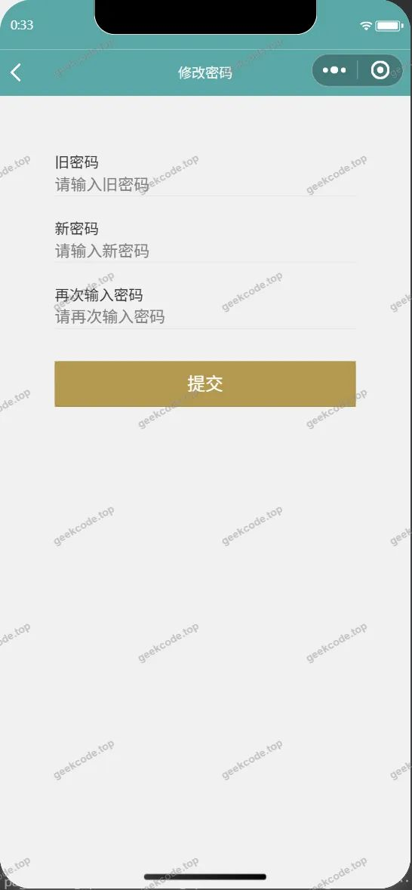</a><figcaption>小程序-changepassword</figcaption></figure>

<h3>后台管理端</h3>
<h4>后台-出院申请</h4>

<a href="https://geekcode.top/archives/%E5%85%BB%E8%80%81%E9%99%A2%E7%AE%A1%E7%90%86%E7%B3%BB%E7%BB%9F%EF%BC%88%E5%B0%8F%E7%A8%8B%E5%BA%8F-%E8%AE%BA%E6%96%87pf?utm_source=github" title="查看完整源码">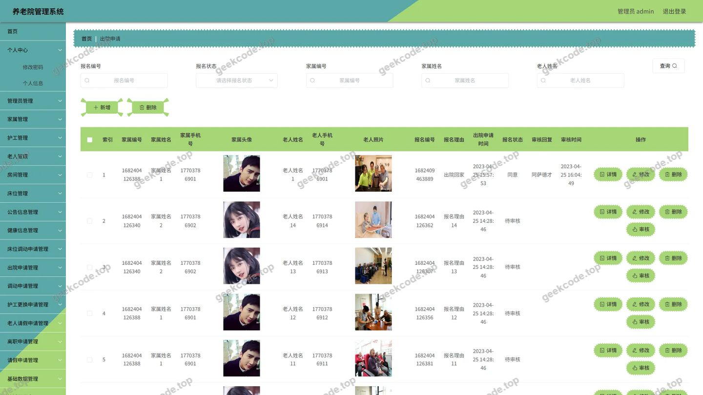</a>

<h4>后台-床位</h4>

<a href="https://geekcode.top/archives/%E5%85%BB%E8%80%81%E9%99%A2%E7%AE%A1%E7%90%86%E7%B3%BB%E7%BB%9F%EF%BC%88%E5%B0%8F%E7%A8%8B%E5%BA%8F-%E8%AE%BA%E6%96%87pf?utm_source=github" title="查看完整源码">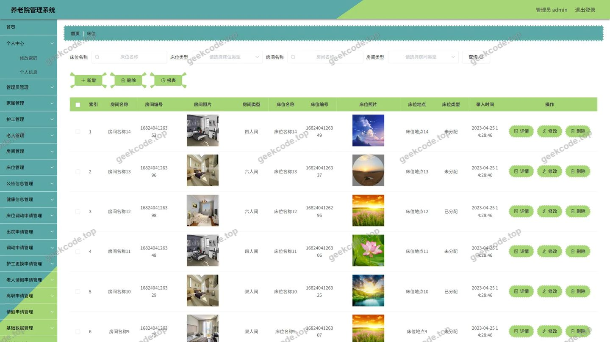</a>

<h4>后台-登录页</h4>

<h4>后台-调动申请</h4>

<a href="https://geekcode.top/archives/%E5%85%BB%E8%80%81%E9%99%A2%E7%AE%A1%E7%90%86%E7%B3%BB%E7%BB%9F%EF%BC%88%E5%B0%8F%E7%A8%8B%E5%BA%8F-%E8%AE%BA%E6%96%87pf?utm_source=github" title="查看完整源码">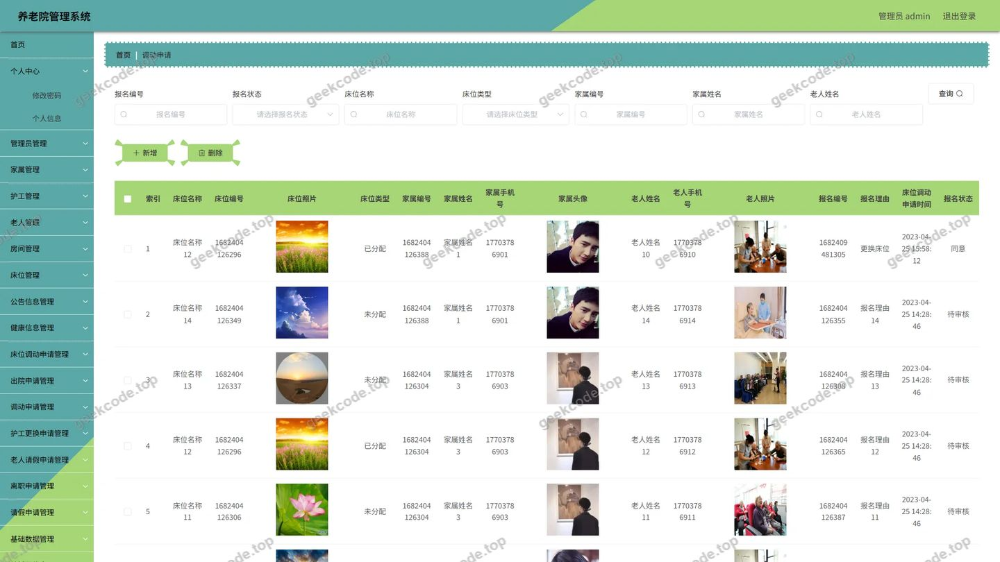</a>

<h4>后台-房间</h4>

<a href="https://geekcode.top/archives/%E5%85%BB%E8%80%81%E9%99%A2%E7%AE%A1%E7%90%86%E7%B3%BB%E7%BB%9F%EF%BC%88%E5%B0%8F%E7%A8%8B%E5%BA%8F-%E8%AE%BA%E6%96%87pf?utm_source=github" title="查看完整源码">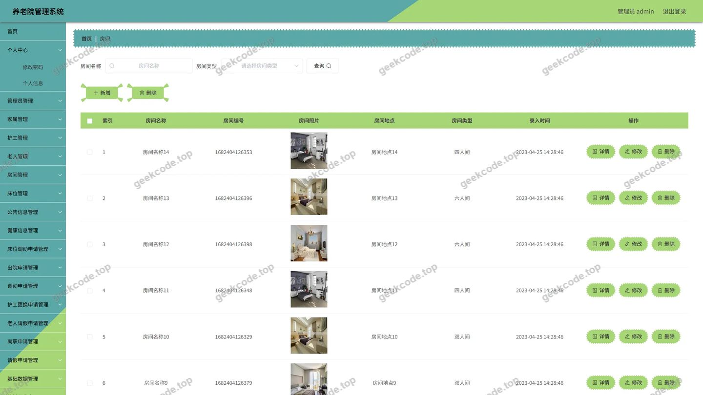</a>

<h4>后台-管理员</h4>

<a href="https://geekcode.top/archives/%E5%85%BB%E8%80%81%E9%99%A2%E7%AE%A1%E7%90%86%E7%B3%BB%E7%BB%9F%EF%BC%88%E5%B0%8F%E7%A8%8B%E5%BA%8F-%E8%AE%BA%E6%96%87pf?utm_source=github" title="查看完整源码">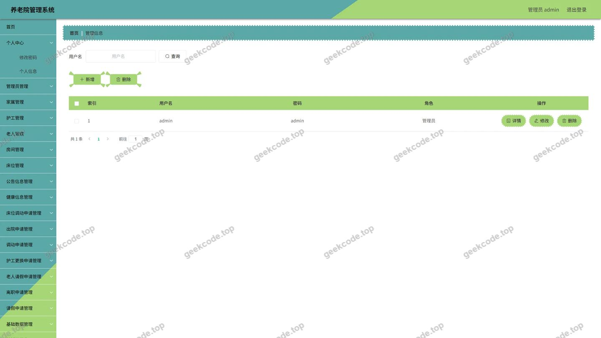</a>

<h4>后台-配置文件</h4>

<a href="https://geekcode.top/archives/%E5%85%BB%E8%80%81%E9%99%A2%E7%AE%A1%E7%90%86%E7%B3%BB%E7%BB%9F%EF%BC%88%E5%B0%8F%E7%A8%8B%E5%BA%8F-%E8%AE%BA%E6%96%87pf?utm_source=github" title="查看完整源码">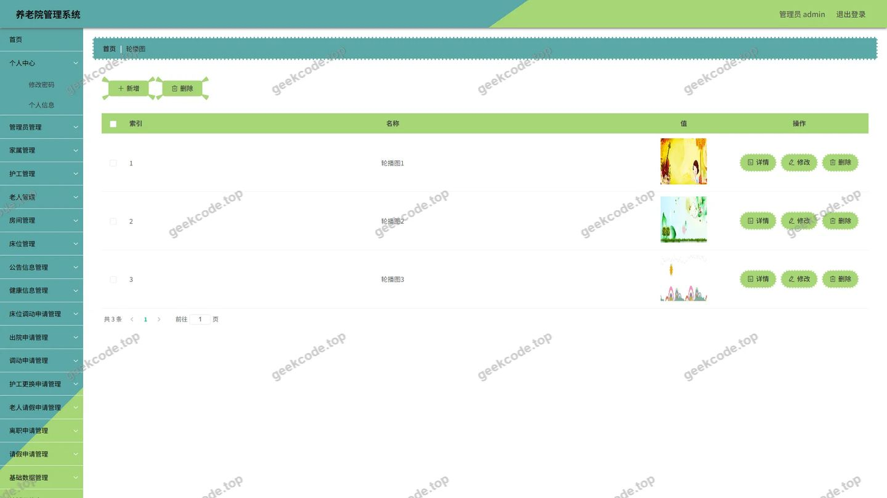</a>

<h4>后台首页</h4>

<a href="https://geekcode.top/archives/%E5%85%BB%E8%80%81%E9%99%A2%E7%AE%A1%E7%90%86%E7%B3%BB%E7%BB%9F%EF%BC%88%E5%B0%8F%E7%A8%8B%E5%BA%8F-%E8%AE%BA%E6%96%87pf?utm_source=github" title="查看完整源码">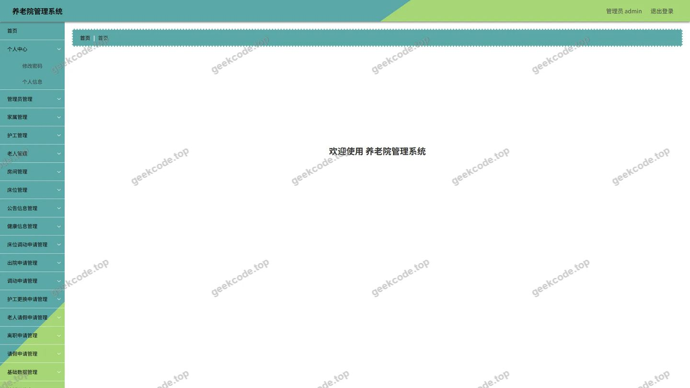</a>

---

## 获取完整源码

| 项目 | 说明 |
| --- | --- |
| 项目名 | 养老院管理系统（小程序--论文pf |
| 运行截图 | 本文 24 张（站点带水印原图，仓库 `images/` 目录） |
| 完整源码 | [https://geekcode.top/archives/%E5%85%BB%E8%80%81%E9%99%A2%E7%AE%A1%E7%90%86%E7%B3%BB%E7%BB%9F%EF%BC%88%E5%B0%8F%E7%A8%8B%E5%BA%8F-%E8%AE%BA%E6%96%87pf?utm_source=github](https://geekcode.top/archives/%E5%85%BB%E8%80%81%E9%99%A2%E7%AE%A1%E7%90%86%E7%B3%BB%E7%BB%9F%EF%BC%88%E5%B0%8F%E7%A8%8B%E5%BA%8F-%E8%AE%BA%E6%96%87pf?utm_source=github) |
| 咨询微信 | **ir9372**（备注：jingpin-yuanma） |
| 更多项目 | [极客代码 geekcode.top](https://geekcode.top/?utm_source=github) |

> 需要源码、部署、改配置、跑不起来等问题，加微信 ir9372 沟通，说明项目名即可。
